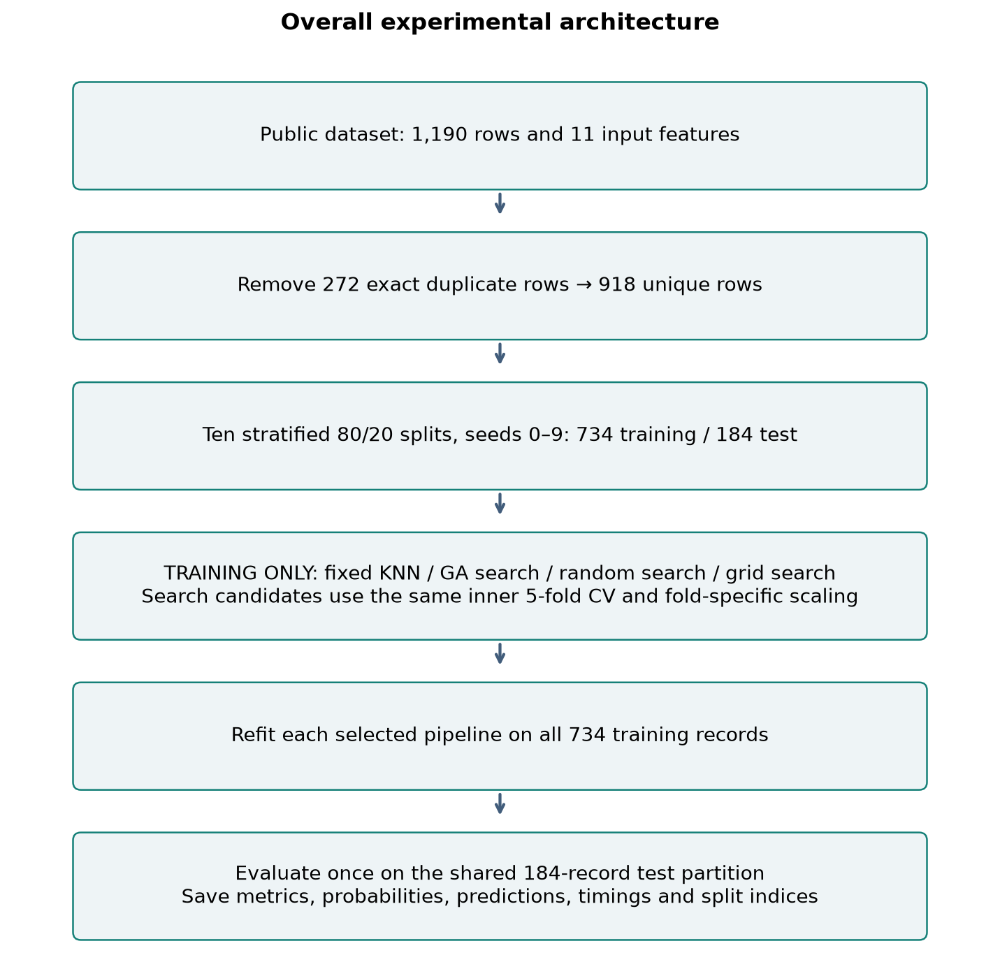
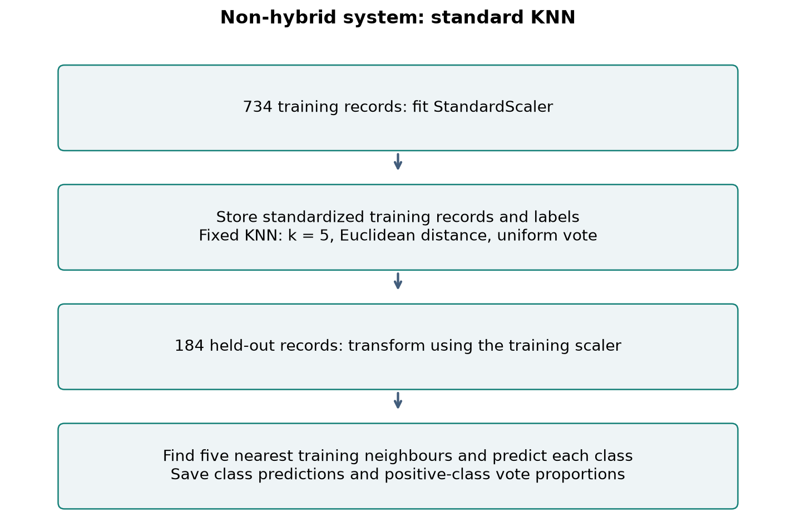
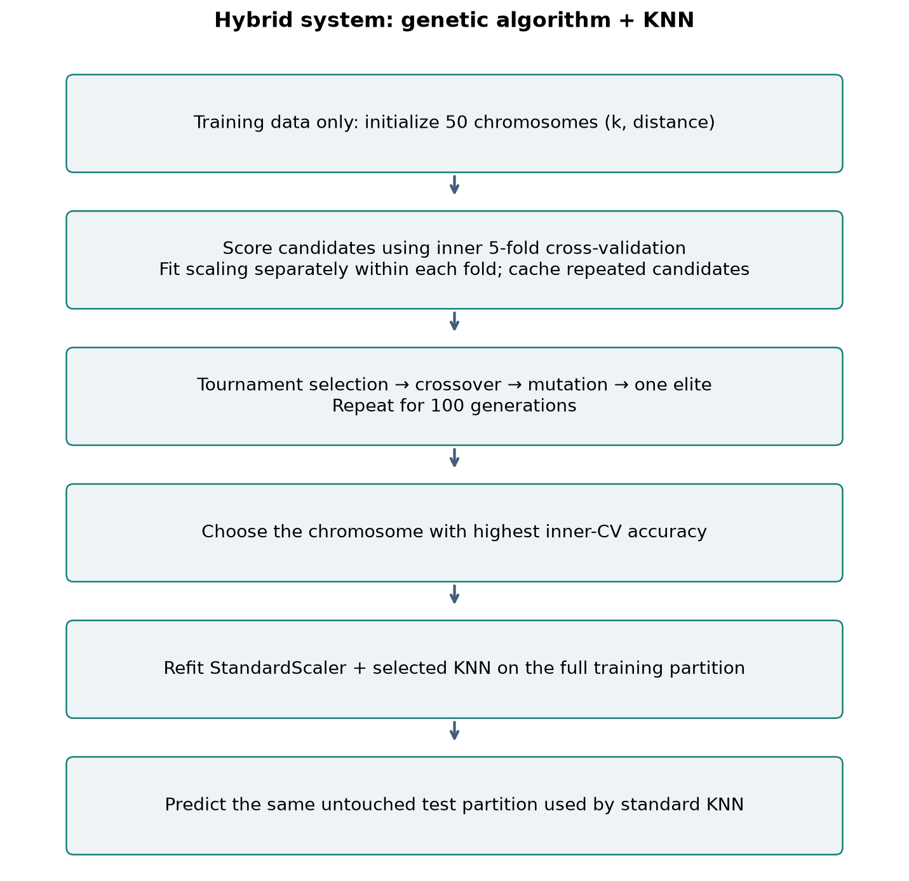
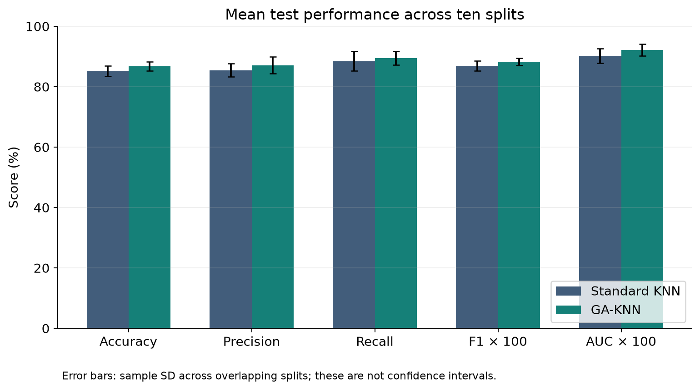
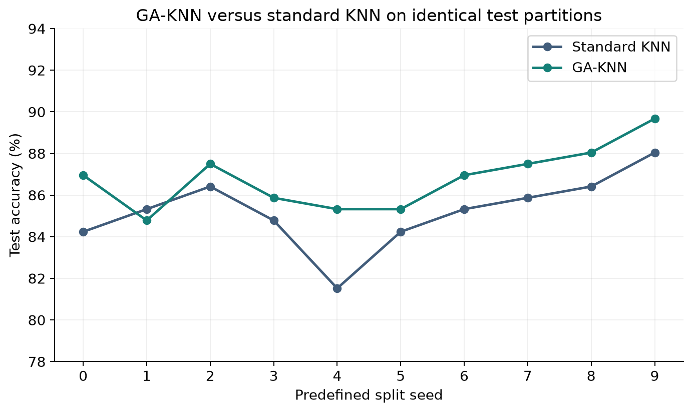
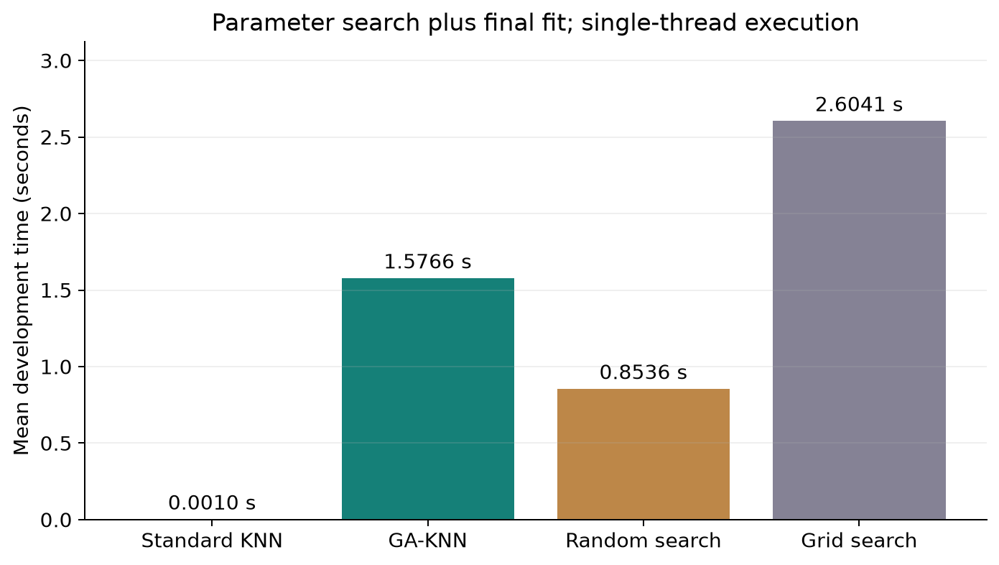
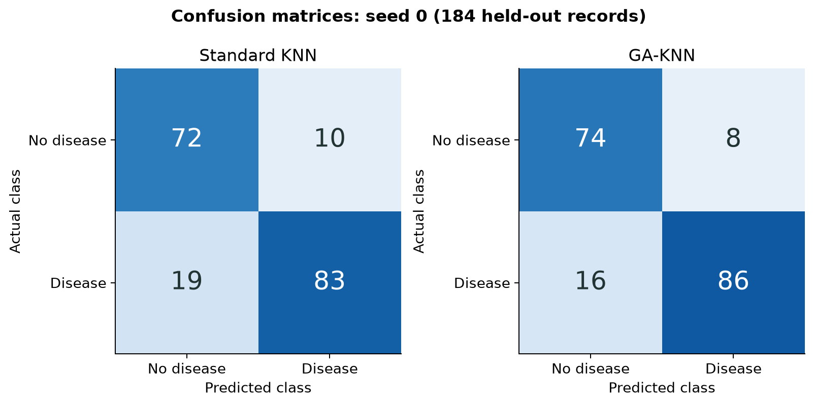
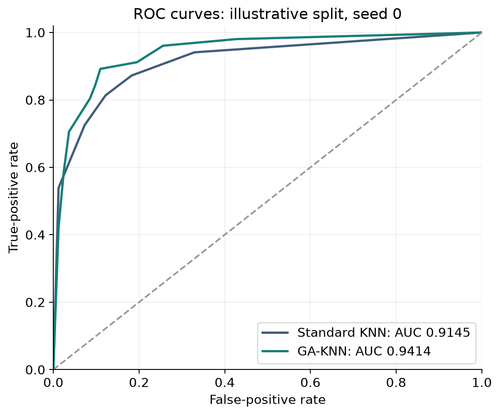
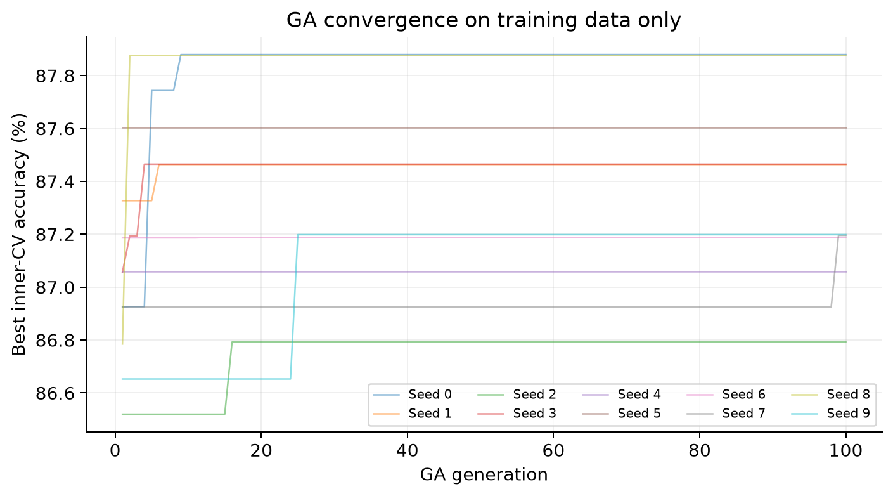

# Comparative Analysis of Standard KNN and Genetic Algorithm–Optimized KNN for Heart Disease Classification

**Mini Project Report — Hybrid vs Non-Hybrid Systems**
**Assignment:** AAT — Hybrid Systems Using Soft Computing Techniques
**Faculty:** Dr Roopashree S

| Submission detail | To be completed by the team |
|---|---|
| Institution and department | [Enter institution and department] |
| Course, semester and section | [Enter course, semester and section] |
| Team member 1 and USN | [Enter name and USN] |
| Team member 2 and USN | [Enter name and USN] |
| Team member 3 and USN | [Enter name and USN] |
| Team member 4 and USN, if applicable | [Enter name and USN, or remove this row] |
| Submission date | [Enter actual submission date] |

**Selected journal paper:** S. H. Murad, N. B. Tayfor, N. H. Mahmood and L. Arman, “Hybrid genetic algorithms-driven optimization of machine learning models for heart disease prediction,” *MethodsX*, vol. 15, article 103510, 2025. [DOI: 10.1016/j.mex.2025.103510](https://doi.org/10.1016/j.mex.2025.103510).

**Scope of this report:** An independently implemented, paper-inspired comparison of KNN and GA-KNN on the public dataset linked by the selected paper. All project results below are computed outputs from the supplied implementation. Published results are identified separately. The experiments classify existing dataset labels; they do not establish prospective clinical risk or clinical readiness.

## Table of Contents

1. Abstract
2. Introduction
   - 2.1 Overview of the Problem Statement
   - 2.2 Motivation for the Project
   - 2.3 Objectives of the Project
3. Literature Review
   - 3.1 Existing Systems and Techniques
   - 3.2 Limitations of Existing Systems
4. System Architecture
   - 4.1 Overall System Block Diagram
5. Non-Hybrid System Design
   - 5.1 Description of the Non-Hybrid Approach
   - 5.2 Algorithms Used
   - 5.3 System Architecture of Non-Hybrid Model
   - 5.4 Implementation Details
   - 5.5 Results of Non-Hybrid System
6. Hybrid System Design (Soft Computing Based)
   - 6.1 Introduction to Hybrid Soft Computing Models
   - 6.2 Techniques Used
   - 6.3 Hybrid System Architecture
   - 6.4 Implementation Details
   - 6.5 Results of Hybrid System
7. Comparative Analysis of Hybrid and Non-Hybrid Systems
   - 7.1 Performance Metrics
   - 7.2 Accuracy Comparison
   - 7.3 Computational Complexity
   - 7.4 Training Time Comparison
   - 7.5 Robustness and Adaptability
   - 7.6 Strengths and Weaknesses of Each Approach
8. Results and Discussion
   - 8.1 Output Analysis
9. Conclusion
   - 9.1 Summary of Work
   - 9.2 Future Scope
10. Applications
11. References

Appendices: A. Reproduction Instructions; B. Experiment Audit; C. Three-Minute Paper Briefing.

## 1. Abstract

This mini project investigates whether a Genetic Algorithm can improve a K-Nearest Neighbours classifier for heart disease classification. A non-hybrid KNN model with five neighbours and Euclidean distance is compared with a hybrid GA-KNN model that selects the number of neighbours and distance metric using evolutionary search. The study uses the public Heart Disease Dataset (Comprehensive) linked by a 2025 MethodsX journal paper. The downloaded file contains 1,190 records and 11 input features. Removing 272 exact duplicates before splitting leaves 918 unique records. Ten predetermined stratified 80:20 train/test splits are evaluated. Parameter selection uses five-fold cross-validation within the training partition, with feature standardization fitted separately inside each fold.

Standard KNN achieves a mean test accuracy of 85.22%, whereas GA-KNN achieves 86.79%, an improvement of 1.58 percentage points. Mean F1 score increases from 0.8688 to 0.8826, and mean ROC-AUC increases from 0.9024 to 0.9223. The hybrid achieves higher accuracy in nine of ten splits. Additional controls show that exhaustive grid search matches GA-KNN, while random search achieves 86.63% mean accuracy. The results support an improvement over fixed-parameter KNN under this protocol, without establishing an advantage unique to GA. The work provides reproducible code, split indices, predictions, probabilities, figures and measured computational costs.

**Keywords:** hybrid systems; soft computing; genetic algorithm; K-nearest neighbours; heart disease classification; public dataset; cross-validation.

## 2. Introduction

### 2.1 Overview of the Problem Statement

The problem is to predict a binary heart disease label from tabular demographic, clinical and exercise-test attributes. Each input record contains 11 measurements or encoded categories, and the output is either class 0, indicating absence of the recorded disease label, or class 1, indicating its presence. The task is supervised binary classification rather than prediction of a future cardiac event.

A KNN classifier assigns a label by examining nearby training examples. Its output depends on how neighbourhoods are defined. A small number of neighbours can make predictions sensitive to individual examples, whereas a large number can smooth away useful local patterns. The distance metric also changes which training examples are considered similar. Therefore, one fixed configuration may perform differently from a configuration selected systematically using training data.

The project compares two systems that share the same features, data partitions and scaling procedure. The non-hybrid system uses fixed KNN parameters. The hybrid system combines evolutionary optimization with KNN classification. This design makes parameter selection the main experimental difference. Random-search and grid-search controls help determine whether any improvement is specific to the evolutionary method or is also achievable through conventional tuning.

### 2.2 Motivation for the Project

The project is motivated by the need to evaluate hybrid systems through reproducible experiments. An increase reported in a journal article is a useful research starting point, but it should be checked under an explicitly documented dataset and evaluation procedure. A public tabular dataset and a relatively simple classifier make it possible to inspect this process closely and explain every stage during a project demonstration.

GA-KNN is suitable for a soft computing assignment because it combines an evolutionary search method with a supervised learning model. The GA maintains alternative parameter combinations, evaluates them, and creates new combinations through selection, crossover and mutation. KNN then uses the selected configuration to classify unseen records. The role of each technique is distinct and easy to illustrate.

Another motivation is fair evaluation. Duplicate records and preprocessing performed before splitting can distort a comparison. This project removes exact duplicates before partitioning and places standardization inside the cross-validation pipeline. The expected outcome is a defensible comparison of predictive performance, variability and computational cost, including situations in which the hybrid does not win.

### 2.3 Objectives of the Project

1. **Design and implement comparable non-hybrid and hybrid classifiers:** develop standard KNN and GA-KNN using the same public dataset, features, scaling pipeline and predetermined train/test partitions, with parameter selection restricted to the training data.
2. **Evaluate the benefits and costs of hybridization:** compare predictive metrics, split-to-split variability, computational complexity and development time, using random search and grid search as additional controls.

## 3. Literature Review

### 3.1 Existing Systems and Techniques

Nearest-neighbour classification is a foundational pattern-recognition approach associated with the work of Cover and Hart [3]. It provides a useful baseline because classification follows directly from distances to stored examples, making the effect of neighbourhood parameters observable.

The selected 2025 study by Murad et al. combines Genetic Algorithms with KNN and SVM parameter selection. It reports GA-KNN accuracy of 95.38% and GA-SVM accuracy of 90% [1]. This project investigates its KNN branch; the SVM branch is outside the implemented scope. The published percentages are reference findings and are not used as project measurements.

Bergstra and Bengio examine random search for hyperparameter optimization and motivate its use as a comparison for more elaborate search procedures [4]. Accordingly, the present experiment includes random search and a complete grid over the same finite parameter space.

Pedregosa et al. describe scikit-learn as a general machine-learning library [5]. Its pipeline, preprocessing and neighbour-classification components support the implementation. The public Kaggle dataset [2] is the actual experimental input; the UCI Heart Disease documentation [6] provides background for common variable meanings, rather than a substitute dataset.

### 3.2 Limitations of Existing Systems

A fixed KNN classifier requires a choice of neighbour count and distance metric. Without systematic selection, these choices may not suit the available records. KNN also depends on feature scaling because measurements with larger numeric ranges can dominate distances. Keeping encoded categories as numbers introduces another limitation: numerical differences between category codes may not represent meaningful clinical similarity.

Hybrid tuning introduces its own limitations. Search repeatedly evaluates candidate models and can overfit its internal validation procedure. A better validation score does not guarantee a better score on unseen data. An optimizer must also be compared with simpler tuning methods before attributing improvements specifically to its search strategy.

Exact reproduction of the selected paper is limited by the availability of its original analysis code, which is offered on request [1]. The present implementation therefore specifies its own search ranges, preprocessing and tie-handling behaviour. It does not claim to reproduce the authors' numerical results.

Finally, this dataset has no patient identifiers or external hospital test cohort in the supplied file. Removing exact duplicate feature-and-label rows reduces one source of overlap but does not establish independence of all underlying patients. Generalization beyond this dataset remains untested.

## 4. System Architecture

### 4.1 Overall System Block Diagram



*Figure 1. Shared data preparation and evaluation architecture.*

The architecture begins with the downloaded dataset. Exact duplicate rows are removed, after which ten stratified partitions are created using seeds 0 through 9. Each partition contains 734 training records and 184 test records. Within a run, every model receives the same partition.

The training branch contains fixed KNN and three parameter-selection strategies: GA, random search and exhaustive grid search. Each search evaluates its candidates on the same five internal folds. A pipeline fits StandardScaler on an inner training fold and applies it to that fold's validation data. This prevents validation measurements from influencing the scaling parameters.

After parameter selection, a fresh pipeline is fitted on all 734 training records. Only then is the held-out test partition transformed and classified. Outputs include class predictions, neighbour-vote proportions, performance metrics and wall-clock timings. Saved split indices and dataset fingerprints make the comparison auditable. The test partition is never used as GA fitness or to choose a parameter configuration.

## 5. Non-Hybrid System Design

### 5.1 Description of the Non-Hybrid Approach

The non-hybrid system consists of a standardization stage followed by a conventional KNN classifier. It uses a fixed neighbour count of five, Euclidean distance, uniform neighbour voting and brute-force distance evaluation. These settings are specified before the repeated evaluation and are not selected from test results.

KNN is a memory-based method. During fitting, it stores the training examples and their labels rather than learning network weights or a parametric decision boundary. For each query, it identifies the five nearest standardized training examples. The predicted class is the class receiving the larger number of votes.

In this report, “non-hybrid” means that the classifier has no separate evolutionary optimizer. Standard feature scaling is a shared preprocessing operation in both systems. The baseline is therefore a reasonable fixed KNN configuration, not a deliberately unscaled or otherwise weakened model. All 11 input features are retained.

### 5.2 Algorithms Used

For input feature j, standardization is:

$$
z_j = \frac{x_j-\mu_j}{\sigma_j}
$$

Here, μ and σ are estimated exclusively from the current training partition or internal training fold. Scikit-learn's StandardScaler uses population variance; a constant feature would receive a scaling factor of one [8].

The Euclidean distance between standardized vectors x and v is:

$$
d_2(x,v)=\sqrt{\sum_{j=1}^{11}(x_j-v_j)^2}
$$

Let Nₖ(x) denote the k nearest training neighbours. Uniform-vote classification is:

$$
\hat y(x)=\operatorname*{arg\,max}_{c\in\{0,1\}}
\sum_{i\in N_k(x)}\mathbb{1}(y_i=c)
$$

The positive-class score is the fraction of selected neighbours labelled 1. It is used for ROC-AUC and is not presented as a calibrated clinical probability. The baseline uses k = 5. Class-vote ties, which may occur for even k during tuning, are resolved by scikit-learn in favour of the first ordered class, class 0. Equal-distance neighbour-boundary ties follow the installed implementation and input ordering [7].

### 5.3 System Architecture of Non-Hybrid Model



*Figure 2. Fixed KNN pipeline.*

The training module receives 734 rows with 11 features. StandardScaler estimates a mean and scale for each feature, transforms the training matrix and passes it to KNN. The classifier retains the transformed examples and their labels.

The evaluation module receives the 184 held-out rows. It applies the training scaler without refitting it, computes distances to stored training examples, selects the nearest five and produces a label and vote proportion for every row. A separate metrics module compares these outputs with the held-out labels.

This architecture is used unchanged across all ten splits. The system contains no feature-selection stage, oversampling procedure or GA component. Its outputs form the reference against which GA-KNN is assessed.

### 5.4 Implementation Details

**Dataset used.** The file is `heart_statlog_cleveland_hungary_final.csv`, downloaded from the Kaggle dataset linked by the selected paper [1, 2].

| Dataset characteristic | Observed value |
|---|---:|
| Original records | 1,190 |
| Exact duplicate rows removed | 272 |
| Unique records used | 918 |
| Input features | 11 |
| Target classes | 0 and 1 |
| Class 0 records | 410 (44.66%) |
| Class 1 records | 508 (55.34%) |
| Explicit missing cells (NaN) | 0 |
| Records with cholesterol equal to zero | 172 |
| Records with resting blood pressure equal to zero | 1 |
| Training/test records per split | 734 / 184 |

The following dictionary gives feature meanings consistent with the supplied column names and background documentation [2, 6]. Observed codes and ranges come directly from the deduplicated file.

| Input column | Meaning | Observed values |
|---|---|---|
| age | Age in years | 28–77 |
| sex | Encoded sex | 0, 1 |
| chest pain type | Encoded chest-pain category | 1–4 |
| resting bp s | Resting blood pressure, mmHg | 0–200 |
| cholesterol | Serum cholesterol, mg/dL | 0–603 |
| fasting blood sugar | Encoded fasting-sugar indicator | 0, 1 |
| resting ecg | Encoded resting ECG category | 0–2 |
| max heart rate | Maximum heart rate achieved | 60–202 |
| exercise angina | Encoded exercise-angina indicator | 0, 1 |
| oldpeak | Exercise-related ST-depression measure | −2.6 to 6.2 |
| ST slope | Encoded ST-slope category | 0–3 |
| target, excluded from inputs | Recorded disease label | 0: absent; 1: present |

**Preprocessing choices.** Exact duplicates are removed across all columns before splitting. No scaling is performed on the full dataset before partitioning. There is no imputation, oversampling, feature elimination or one-hot encoding. Zero cholesterol and zero blood-pressure entries are retained as supplied, although they are questionable physiological measurements and may encode unavailable values. ST slope includes a zero code; no unverified clinical meaning is assigned to it.

All numeric category codes are standardized alongside continuous features. This choice is shared by both models but limits how faithfully distances represent categorical similarity. The experiment evaluates this explicitly defined representation rather than an optimized clinical preprocessing pipeline.

### 5.5 Results of Non-Hybrid System

Across ten stratified splits, standard KNN obtains:

| Metric | Mean | Sample SD across splits |
|---|---:|---:|
| Accuracy (%) | 85.22 | 1.73 |
| Precision (%) | 85.49 | 2.23 |
| Recall (%) | 88.43 | 3.23 |
| Specificity (%) | 81.22 | 3.55 |
| Balanced accuracy (%) | 84.83 | 1.74 |
| F1 score | 0.8688 | 0.0164 |
| ROC-AUC | 0.9024 | 0.0242 |

Accuracy ranges from 81.52% to 88.04%. The variation indicates that the composition of the held-out records affects performance even when the algorithm and its parameters remain fixed.

For the illustrative split with seed 0, the confusion matrix is:

| Actual class | Predicted 0 | Predicted 1 |
|---|---:|---:|
| 0: disease absent | 72 | 10 |
| 1: disease present | 19 | 83 |

The classifier correctly labels 155 of 184 test records, producing 84.24% accuracy on this split. Its 19 false negatives and 10 false positives show why accuracy alone is insufficient to characterize the output. Seed 0 is used consistently for illustration, rather than selecting the run with the most favourable result.

## 6. Hybrid System Design (Soft Computing Based)

### 6.1 Introduction to Hybrid Soft Computing Models

A hybrid soft computing system combines complementary techniques within one solution. In this project, the Genetic Algorithm searches for a KNN configuration, while KNN performs classification. The evolutionary component addresses parameter selection, and the classifier evaluates similarity between records.

The system is hybrid because it couples population-based optimization with supervised prediction. It does not use a neural network, fuzzy inference engine or ANFIS. Those are possible hybrid approaches, but they are not components of this implementation.

The optimization objective is mean inner cross-validation accuracy on training data. A candidate that performs well on these folds is retained and may contribute parameter values to later generations. After the evolutionary process, the selected configuration is refitted on the full outer training partition and evaluated on held-out data. This separation allows the effect of hybridization to be measured without allowing test labels to steer the search.

### 6.2 Techniques Used

Each chromosome has two genes:

$$
\theta=(k,m),\qquad k\in\{1,\ldots,51\},\quad
m\in\{\text{Euclidean, Manhattan, Chebyshev}\}
$$

The search space contains 51 × 3 = 153 distinct configurations. The additional distances are:

$$
d_1(x,v)=\sum_{j=1}^{11}|x_j-v_j|,\qquad
d_\infty(x,v)=\max_j|x_j-v_j|
$$

For five internal folds, candidate fitness is:

$$
F(\theta)=\frac{1}{5}\sum_{f=1}^{5}
\operatorname{Accuracy}(y_f,\hat y_f(\theta))
$$

Tournament selection draws three population indices with replacement and chooses the highest-scoring candidate. With crossover probability 0.8, a child takes k from the first parent and the metric from the second. Otherwise it copies the first parent. With chromosome-level probability 0.1, one randomly selected gene is replaced by a randomly sampled valid value; replacement may leave its value unchanged.

One elite is copied to each new generation. Repeated candidate evaluations are cached because fitness is deterministic for fixed folds. The baseline configuration is included in the initial population. This supports a non-decreasing best training-validation score, but it does not guarantee improved test performance.

### 6.3 Hybrid System Architecture



*Figure 3. Genetic Algorithm coupled with the KNN training pipeline.*

The GA controller operates entirely within the 734-record training partition. It first creates 50 chromosomes and evaluates each using the internal cross-validation pipeline. The controller then creates successive populations using selection, crossover, mutation and elitism.

The fitness evaluator is separate from the outer test evaluator. Every candidate is fitted on four internal folds and validated on the fifth, repeating for all five folds. Scaling is learned separately during each fit. Candidate fitness is the arithmetic mean of the five validation accuracies.

After 100 evolutionary updates, the highest-scoring final-population chromosome is selected. A new scaler and KNN classifier are fitted on all training records. The resulting pipeline processes the untouched test partition. The inference system contains the selected KNN and scaler; the GA does not run for every prediction.

### 6.4 Implementation Details

| Setting | Implemented value |
|---|---|
| Population size | 50 |
| Evolutionary updates | 100 |
| Chromosome | Neighbour count and distance index |
| Fitness | Mean five-fold inner-CV accuracy |
| Selection | Tournament, size 3, sampling with replacement |
| Crossover | One-point between two genes, probability 0.8 |
| Mutation | Probability 0.1 per child; replace one gene |
| Elitism | One best chromosome retained |
| Initial baseline candidate | k = 5, Euclidean |
| Repeated fitness evaluations | Cached within a search |
| Candidate voting | Uniform |
| Outer seeds | 0–9 |
| Inner folds | Stratified, shuffled, fixed by outer seed |
| Final model selection | Inner-CV score only |

The code uses NumPy's seeded random generator for evolutionary operations. New children in the final population are scored before the final chromosome is returned. The convergence plot records the best fitness at the start of each of the 100 generations; the final selection also evaluates the population produced by the last update.

Random search evaluates 50 distinct uniformly sampled configurations without replacement. Grid search evaluates all 153 configurations. Both use the same internal folds, feature processing and accuracy objective as GA. Each search receives an independent cache, so its measured runtime includes its own candidate evaluations. These controls do not have equal evaluation budgets and are not used to claim equal-budget optimizer superiority.

The script saves the selected parameters, convergence history, train/test indices, class probabilities, predictions, timings and summary statistics. Search bounds and preprocessing are project choices, so the implementation is described as paper-inspired rather than a verified copy of the authors' code.

### 6.5 Results of Hybrid System

Across ten stratified splits, GA-KNN obtains:

| Metric | Mean | Sample SD across splits |
|---|---:|---:|
| Accuracy (%) | 86.79 | 1.49 |
| Precision (%) | 87.15 | 2.72 |
| Recall (%) | 89.51 | 2.27 |
| Specificity (%) | 83.41 | 4.19 |
| Balanced accuracy (%) | 86.46 | 1.68 |
| F1 score | 0.8826 | 0.0122 |
| ROC-AUC | 0.9223 | 0.0194 |

Mean accuracy improves by 1.58 percentage points compared with fixed KNN. The hybrid wins on nine splits and loses on one. Its test accuracy ranges from 84.78% to 89.67%. Manhattan distance is selected in every run, while the selected neighbour counts vary between 9 and 21.

For seed 0, GA selects k = 9 and Manhattan distance. Its confusion matrix is:

| Actual class | Predicted 0 | Predicted 1 |
|---|---:|---:|
| 0: disease absent | 74 | 8 |
| 1: disease present | 16 | 86 |

This yields 160 correct predictions out of 184, or 86.96% accuracy. Compared with the baseline on the same records, false negatives decrease from 19 to 16 and false positives decrease from 10 to 8.

## 7. Comparative Analysis of Hybrid and Non-Hybrid Systems

### 7.1 Performance Metrics

The positive class is disease present, target = 1. TP and TN are correctly predicted positive and negative labels; FP and FN are the corresponding mistakes.

| Metric | Definition | Interpretation |
|---|---|---|
| Accuracy | (TP + TN) / (TP + TN + FP + FN) | Overall fraction correctly classified |
| Precision | TP / (TP + FP) | Fraction of positive predictions that are correct |
| Recall / sensitivity | TP / (TP + FN) | Fraction of positive records identified |
| Specificity | TN / (TN + FP) | Fraction of negative records identified |
| F1 score | 2 × precision × recall / (precision + recall) | Balance of precision and recall |
| Balanced accuracy | (Sensitivity + specificity) / 2 | Equal-weight average of class recalls |
| ROC-AUC | Area under the ROC curve | Ranking performance across score thresholds |

Metrics are calculated separately on each test partition, then averaged. F1 is calculated per split before averaging; it is not reconstructed from the averaged precision and recall. Sample SD uses a denominator of nine. The split partitions overlap, so SD is a descriptive measure of variation, not an independent-sample confidence interval.



*Figure 4. Mean scores and sample SD across ten overlapping holdouts.*

### 7.2 Accuracy Comparison

| Model | Mean accuracy ± SD | Mean F1 | Mean ROC-AUC |
|---|---:|---:|---:|
| Standard KNN | 85.22% ± 1.73 | 0.8688 | 0.9024 |
| GA-KNN | 86.79% ± 1.49 | 0.8826 | 0.9223 |
| Random-search KNN | 86.63% ± 1.64 | 0.8809 | 0.9235 |
| Grid-search KNN | 86.79% ± 1.49 | 0.8826 | 0.9223 |

The complete split-level accuracy comparison is:

| Seed | Standard KNN | GA-KNN | Change, percentage points | Selected k | Distance |
|---|---:|---:|---:|---:|---|
| 0 | 84.24% | 86.96% | +2.72 | 9 | Manhattan |
| 1 | 85.33% | 84.78% | -0.54 | 9 | Manhattan |
| 2 | 86.41% | 87.50% | +1.09 | 21 | Manhattan |
| 3 | 84.78% | 85.87% | +1.09 | 9 | Manhattan |
| 4 | 81.52% | 85.33% | +3.80 | 9 | Manhattan |
| 5 | 84.24% | 85.33% | +1.09 | 15 | Manhattan |
| 6 | 85.33% | 86.96% | +1.63 | 15 | Manhattan |
| 7 | 85.87% | 87.50% | +1.63 | 9 | Manhattan |
| 8 | 86.41% | 88.04% | +1.63 | 9 | Manhattan |
| 9 | 88.04% | 89.67% | +1.63 | 11 | Manhattan |



*Figure 5. Identical held-out partitions for the main comparison.*

GA-KNN improves mean accuracy from 85.22% to 86.79%, but it does not win every split. Seed 1 shows a decrease of 0.54 percentage points. Grid search matches GA-KNN's selected configuration in all ten runs. The evidence therefore supports the benefit of tuning this KNN baseline, while leaving no observed accuracy advantage for GA over exhaustive search in this small space.

### 7.3 Computational Complexity

Let n be training size, d = 11 the feature count, q the number of queries, E the number of distinct evaluated configurations and F = 5 the number of internal folds.

For the configured brute-force KNN, scaling and storing training records require approximately O(nd) work and O(nd) storage. Distance evaluation during inference requires O(qnd) arithmetic, with additional neighbour selection and voting. The configured algorithm does not build a KD-tree. Both systems have the same general inference structure after parameter selection, although their chosen distances and k values affect runtime constants.

For hybrid development, the repeated cross-validation evaluations dominate the search. The distance-computation component is approximately O(EFn²d), ignoring fixed fold-size fractions. GA also performs population bookkeeping, selection, crossover and mutation. Cached duplicate chromosomes avoid repeating their cross-validation fits. In this experiment, GA evaluates between 80 and 98 distinct configurations per split, compared with 153 for the grid.

GA does not reduce the number of input features in this project. It selects only k and the distance metric, so no feature-reduction or memory-reduction claim is made.

### 7.4 Training Time Comparison

KNN is a lazy learner, making final fit time alone a misleading estimate of the work required to build the hybrid. The following table separates parameter-search time from the final scaler-and-classifier fit.

| Model | Mean search time, s | Mean final fit, ms | Mean total development, s | Mean prediction for 184 records, ms |
|---|---:|---:|---:|---:|
| Standard KNN | 0.0000 | 1.033 | 0.0010 | 1.134 |
| GA-KNN | 1.5755 | 1.112 | 1.5766 | 1.774 |
| Random-search KNN | 0.8524 | 1.156 | 0.8536 | 1.861 |
| Grid-search KNN | 2.6030 | 1.023 | 2.6041 | 1.668 |



*Figure 6. Mean parameter-search time plus final fit, excluding test scoring.*

Timings use a wall clock, single-thread limits, and sequential execution on macOS-26.6.2-arm64-arm-64bit (arm64; 15 logical CPUs reported; numerical thread limit = 1). Final fit includes StandardScaler fitting and KNN storage. Prediction time measures the class-prediction call only; the additional probability call and metric computation are excluded. Total development time is search time plus final fit time.

The measurements show a trade-off: the hybrid improves predictive performance over fixed KNN but requires extra development work. GA is faster than the full grid in these runs, while random search is faster than GA. These are observed wall times for unequal search budgets on one machine, not a controlled hardware benchmark or proof of general efficiency. Millisecond-scale measurements are particularly sensitive to execution overhead.

### 7.5 Robustness and Adaptability

The main robustness evidence is variation across the ten predetermined partitions. Accuracy SD is 1.73 percentage points for fixed KNN and 1.49 for GA-KNN. The hybrid's improvement appears in nine partitions, supporting consistency within this dataset under the implemented split procedure.

Nevertheless, these runs reuse records across different test partitions and do not represent ten independent patient cohorts. The experiment does not assess resistance to noisy sensors, hospital-to-hospital distribution shifts, adversarial changes or missing measurements. It also does not test calibration, demographic fairness or prospective clinical performance.

GA provides adaptability during development by selecting a configuration for each training partition. The selected k values differ across runs, reflecting different training samples. This is not online learning: once deployed, the fitted pipeline remains fixed until it is explicitly retrained. Handling new populations would require new data and an appropriate validation study.

### 7.6 Strengths and Weaknesses of Each Approach

| Approach | Strengths observed or inherent to this design | Limitations |
|---|---|---|
| Standard KNN | Simple architecture; minimal fitting cost; transparent neighbour-vote mechanism | Fixed similarity choices; lower average performance here; sensitivity to feature representation |
| GA-KNN | Automated parameter selection; higher mean test scores than baseline; reaches grid-optimal inner-CV score in all runs | Extra computation; stochastic search; no observed advantage over grid in final performance; no external validation |
| Random-search KNN | Simple control; lower measured search time; mean accuracy close to GA | Samples only 50 of 153 candidates; no guarantee of the best validation score |
| Grid-search KNN | Examines the whole stated space; clear reference optimum for inner-CV score | More candidate evaluations here; grows rapidly with additional parameters |

GA's best training-validation score is preserved by elitism, while generalization is still determined by unseen examples. The loss on seed 1 illustrates this distinction. For this small parameter space, conventional tuning remains a competitive engineering choice.

## 8. Results and Discussion

### 8.1 Output Analysis

**Confusion-matrix analysis.** On the shared seed-0 test partition, the hybrid makes five fewer errors overall than fixed KNN. Three are reductions in false negatives and two are reductions in false positives. This example helps explain how an accuracy increase arises, but the ten-split averages remain the primary project result.



*Figure 7. Seed-0 confusion matrices; rows are actual classes and columns are predictions.*

**Score analysis.** ROC curves use neighbour-vote proportions, rather than hard class labels, as the continuous score. On seed 0, ROC-AUC increases from 0.9145 to 0.9414. Across all ten splits, mean ROC-AUC increases from 0.9024 to 0.9223. AUC describes discrimination; it does not demonstrate calibrated medical probabilities.



*Figure 8. ROC curves for seed 0, used as a fixed illustrative split.*

**Optimization analysis.** The convergence curves show the best internal validation score recorded in each GA generation. Flat regions indicate that the currently best candidate remains unbeaten; they do not imply a lack of candidate exploration. In all ten runs, the GA's selected score equals the exhaustive grid's highest score.



*Figure 9. Best inner-CV accuracy during search. No test accuracy is used in these curves.*

**Interpretation of the improvement.** The hybrid selects Manhattan distance in every run and larger neighbourhoods than the baseline. These changes modify the neighbourhood geometry and smooth local voting. However, both parameters change together, so this experiment does not isolate the contribution of k from the contribution of the distance metric. A one-factor-at-a-time ablation would be needed for that conclusion.

**Comparison with the journal result.** The selected paper reports 95.38% for GA-KNN [1]. This project's mean of 86.79% is 8.59 percentage points lower. The paper's figure is not presented as reproduced. Duplicate removal, preprocessing, partitions, search ranges and implementation details can affect results, but the experiment does not establish which factor explains the discrepancy. A controlled replication with the authors' exact code and settings would be needed.

**Limits of the evidence.** Removing exact duplicates does not verify patient identity. The dataset's historical origin and combined structure limit conclusions about new populations. Retained zero-valued measurements and numerically encoded categories are additional representation limitations. The observed nine-to-one win count and descriptive SD are not a statistical significance test; no p-value or population-wide superiority claim is asserted.

**Auditability.** All 40 prediction sets—four approaches on ten splits—are saved. The verification script checks their labels, probabilities, confusion matrices and derived metrics against the source records. Selected parameters and full train/test row indices are available in the results file. These outputs support a project demonstration based on computed evidence rather than manually entered performance claims.

## 9. Conclusion

### 9.1 Summary of Work

The project implements a non-hybrid KNN classifier and a hybrid Genetic Algorithm–KNN classifier on a public heart disease dataset. Exact duplicates are removed before splitting, parameter selection is confined to training data, and the systems are assessed on the same ten stratified holdouts.

GA-KNN achieves 86.79% mean accuracy compared with 85.22% for fixed KNN, improving mean accuracy by 1.58 percentage points. Mean F1 score and ROC-AUC also improve, and the hybrid wins on nine splits. This meets the project's objective of demonstrating and evaluating a soft computing hybrid against its non-hybrid baseline.

The additional controls qualify the conclusion: grid search reaches the same final predictive performance, and random search is close. Thus, GA is an effective tuning method in this experiment, but its superiority over conventional tuning is not established. The report's conclusions apply to the implemented protocol and dataset, and the journal's 95.38% accuracy is not claimed as replicated.

### 9.2 Future Scope

Future work can investigate better handling of zero-valued measurements, one-hot encoding or mixed-type distance functions, and the effect of individual parameter changes. These alternatives should be selected using training data and evaluated under a newly specified protocol.

A larger search could include distance weighting or feature subsets, making the optimization problem more demanding. GA could then be compared with random search under equal numbers of distinct candidate evaluations. External patient cohorts, group-aware partitions where identifiers are available, calibration and subgroup analysis would provide stronger generalization evidence.

Finally, obtaining the authors' original code would allow a controlled examination of the gap between the published and independently measured results.

## 10. Applications

The implemented system is useful as an academic demonstration of evolutionary optimization, a reproducible classification benchmark, and a teaching example for fair comparisons between hybrid and non-hybrid methods. Its saved predictions and diagrams can support a classroom demonstration of neighbourhood voting and validation-based parameter selection.

The same software structure can be adapted to other public tabular classification tasks by changing the data loader, feature representation and evaluation protocol. Examples include educational outcome classification or industrial condition monitoring, provided the labels and data splitting rules suit the new application.

In a healthcare research setting, the system could serve as a baseline for a more comprehensive validation study. The present results alone do not justify automated diagnosis, patient treatment decisions or deployment as a clinical screening device.

## 11. References

1. S. H. Murad, N. B. Tayfor, N. H. Mahmood and L. Arman, “Hybrid genetic algorithms-driven optimization of machine learning models for heart disease prediction,” *MethodsX*, vol. 15, article 103510, 2025. [DOI](https://doi.org/10.1016/j.mex.2025.103510). **Selected 2025 journal paper.**
2. Kaggle, “Heart Disease Dataset (Comprehensive),” dataset identifier `sid321axn/heart-statlog-cleveland-hungary-final`. [Dataset](https://www.kaggle.com/datasets/sid321axn/heart-statlog-cleveland-hungary-final). **Actual dataset used; public listing identifies the licence as CC0.**
3. T. M. Cover and P. E. Hart, “Nearest neighbor pattern classification,” *IEEE Transactions on Information Theory*, vol. 13, no. 1, pp. 21–27, 1967. [DOI](https://doi.org/10.1109/TIT.1967.1053964).
4. J. Bergstra and Y. Bengio, “Random search for hyper-parameter optimization,” *Journal of Machine Learning Research*, vol. 13, pp. 281–305, 2012. [Article](https://jmlr.org/papers/v13/bergstra12a.html).
5. F. Pedregosa et al., “Scikit-learn: Machine learning in Python,” *Journal of Machine Learning Research*, vol. 12, pp. 2825–2830, 2011. [Article](https://jmlr.org/papers/v12/pedregosa11a.html).
6. UCI Machine Learning Repository, “Heart Disease,” dataset documentation. [Repository](https://archive.ics.uci.edu/dataset/45/heart+disease). **Background documentation; the original UCI file is not the exact input file used here.**
7. Scikit-learn developers, “KNeighborsClassifier,” API documentation. [Documentation](https://scikit-learn.org/stable/modules/generated/sklearn.neighbors.KNeighborsClassifier.html).
8. Scikit-learn developers, “StandardScaler,” API documentation. [Documentation](https://scikit-learn.org/stable/modules/generated/sklearn.preprocessing.StandardScaler.html).

Online resources were checked during report preparation. The selected research paper meets the 2025/2026 requirement; older entries provide foundational and software references.

## Appendix A. Reproduction Instructions

### A.1 Software and execution environment

- **python:** 3.12.14
- **numpy:** 2.5.4
- **pandas:** 3.0.6
- **sklearn:** 1.9.1
- **platform:** macOS-26.6.2-arm64-arm-64bit
- **machine:** arm64
- **logical_cpu_count:** 15
- **thread_limit:** 1

The supplied requirements file pins the installed packages. Timings may change with hardware, background load and library implementations. Fixed seeds and the supplied dataset allow the predictive comparison to be repeated in the recorded environment.

### A.2 Files supplied

| File | Purpose |
|---|---|
| `Mini_Project_Report.md` | This report |
| `run_comparison.py` | Main experiment: fixed KNN, GA, random and grid search |
| `generate_figures.py` | Builds report figures from saved outputs |
| `verify_results.py` | Audits dataset/code fingerprints, partitions and metrics |
| `heart_statlog_cleveland_hungary_final.csv` | Original downloaded public data |
| `requirements.txt` | Pinned package versions |
| `results.json` | Dataset metadata, selected parameters, split indices, timings and metrics |
| `predictions.json` | Test labels, predictions and positive-class vote proportions |
| `figures/` | Architecture diagrams and computed charts |

### A.3 Run the experiment

Open a terminal in the extracted project folder and run:

```bash
python3 -m venv .venv
source .venv/bin/activate
python -m pip install -r requirements.txt
python run_comparison.py
python verify_results.py
python generate_figures.py
```

The default input is the CSV beside the script, and outputs are written beside the script. A separate experiment output folder can be selected with:

```bash
python run_comparison.py --data heart_statlog_cleveland_hungary_final.csv --output rerun
```

The verification and figure scripts use the delivered files beside themselves. To verify or visualize a separate rerun with these scripts, first copy its `results.json` and `predictions.json` into a copy of the project folder. Training does not download anything automatically.

The Markdown report references images in the adjacent `figures` folder. Keep the folder with the report when sharing or converting it. Markdown does not have fixed physical pages; the requested half-page sections are organized by topic, and final page lengths depend on the font, margins and document exporter.

## Appendix B. Experiment Audit

The following checks passed on the delivered experiment:

- Dataset fingerprint matches the downloaded input.
- Model-code fingerprint matches the code used to produce the results.
- All ten partitions contain 734 training and 184 test indices, with no intersection within a run.
- No duplicate feature rows remain in the 918-row input used for splitting.
- All 40 prediction vectors align with their saved test-row indices and source labels.
- Probabilities reproduce their saved ROC-AUC values, and class predictions reproduce the confusion matrices.
- All reported accuracy, precision, recall, specificity, balanced accuracy and F1 values can be recalculated from saved predictions.
- Summary means and sample SD values match the ten run-level outputs.
- Development time equals search time plus final fit time.
- The GA convergence histories are non-decreasing.
- The code update preserves all predictive metrics from the initial experiment.

These checks establish consistency of the delivered artifacts. They do not replace external validation or prove that all underlying patients are independent.

**Dataset SHA-256:**

```text
7d7dc50ab0883efba2bd52e6aac4a273407f48fefe2f1e2503f202c82e6b36be
```

## Appendix C. Three-Minute Paper Briefing

Our selected paper is “Hybrid genetic algorithms-driven optimization of machine learning models for heart disease prediction,” published in MethodsX in 2025.

The problem is binary heart disease classification using tabular measurements such as age, chest-pain category, blood pressure, cholesterol, maximum heart rate and exercise-test indicators. The paper links a public Kaggle dataset. Our downloaded file has 1,190 records and 11 input features. We removed 272 exact duplicates before splitting, leaving 918 unique records.

Our non-hybrid model is standard KNN with five neighbours and Euclidean distance. Our hybrid model combines a Genetic Algorithm with KNN. The GA selects the neighbour count and distance metric, while KNN performs the classification. We search 153 parameter combinations using a population of 50 and 100 evolutionary updates.

For fair evaluation, we use ten predetermined stratified 80:20 splits. Each split contains 734 training records and 184 test records. The GA uses five-fold cross-validation inside the training partition, and scaling is fitted separately within each fold. The test data is used only after parameter selection.

Standard KNN achieves 85.22% average accuracy, while GA-KNN achieves 86.79%. The improvement is 1.58 percentage points, with the hybrid winning on nine of ten splits. Mean F1 and ROC-AUC also improve. The hybrid selects Manhattan distance in every run.

We also tested random search and grid search. Grid search matches GA-KNN's results, so our conclusion is that hybrid tuning improves this fixed KNN baseline, without demonstrating a unique advantage over conventional tuning.

The paper reports a higher accuracy of 95.38%, which we have not reproduced. Our report distinguishes that published result from our own measurements. We provide the code, predictions, figures and limitations, including retained zero-valued measurements, encoded categories and the absence of external validation.
